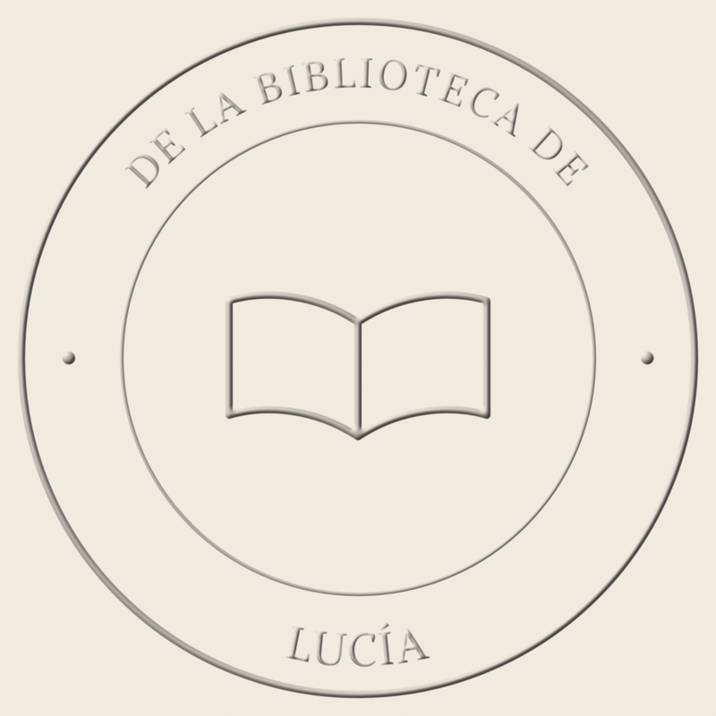

# 04 · Producción: fotografiar, simular y componer el relieve

Investigación del 03/11/2026. Profundiza la sección 5 del manual con tres cosas concretas:
1. Cómo fotografiar el relieve real.
2. Una herramienta propia que genera la vista previa y el relieve simulado sin IA (`herramientas/generar-sellos.mjs`, probada).
3. Cómo usar las referencias de los modelos de imagen y video para que el aparato salga fiel.

---

## 1. Árbol de decisión: ¿de dónde sale el sello en cada pieza?

```
¿El texto del sello se lee en la pieza?
├── NO (plano lejano, desenfocado) ──► Escena con IA, con la hoja lisa. Fin.
└── SÍ
    ├── ¿Es el "momento de verdad" (primer plano del relieve, antes/después, demo)?
    │     └── SÍ ──► FOTO o VIDEO REAL. Sin excepciones.
    └── NO (escena de contexto, carrusel, tarjeta de diseño)
          ├── Vista plana (tarjeta de diseño, personalizador) ──► PNG de generar-sellos (--png)
          └── Sobre una hoja en la escena ──► PNG de relieve (--relieve) o PNG + "Bisel y relieve"
                                             compuesto encima, y comparado con la foto real
```

---

## 2. Fotografiar el relieve real (con celular)

El sello seco no tiene tinta: **lo que se fotografía son luces y sombras**. Las fuentes coinciden en dos estrategias opuestas, y conviene tener las dos:

| Estrategia | Cómo | Para qué | Fuente |
|---|---|---|---|
| **Luz rasante (baja)** | Una sola luz casi paralela a la hoja (5–20°), desde arriba a la izquierda. Linterna del celular o lámpara con el resto del cuarto oscuro | Máximo contraste del relieve: **gancho, ASMR, macro "mirá cómo queda"** | Práctica habitual para revisar relieves con una linterna a ángulo bajo ([Snap, guía de embossing](https://snap.com.au/blog/complete-guide-to-embossing-and-debossing)) |
| **Luz lateral difusa** | Ventana de costado con una cortina, o dos fuentes difusas laterales | Relieve legible sin sombras duras: **foto de catálogo, carrusel** | Recomendación para fotografiar tarjetas en relieve: varias fuentes difusas desde los costados para evitar sombras duras ([UniquePhoto, Q&A](https://www.uniquephoto.com/community/qa/how-can-i-consistently-photograph-embossed-calligraphy-cards-with-fine-detail)) |

**Receta para el celular:**
1. Usá la hoja **crema** del libro (mejor contraste que el blanco puro) y apoyá el libro en una superficie oscura y mate.
2. Celular en trípode o sobre una pila de libros, **paralelo a la hoja** para que el círculo no se deforme.
3. Modo **macro** o lente 2× a unos 10–15 cm (con el gran angular de cerca se curva). **Bloqueá enfoque y exposición** (mantené apretado sobre el sello).
4. Bajá la exposición −0,3 a −0,7 para que las luces del relieve no se quemen.
5. Video: **un solo movimiento lento** de la luz (linterna que se desliza de izquierda a derecha) hace que el relieve "aparezca". Es el plano más fuerte para un gancho.
6. Grabá el **sonido del clic** aparte, con el celular a 10 cm, en un lugar silencioso.

---

## 3. Herramienta propia: `herramientas/generar-sellos.mjs`

Genera, para una lista de nombres:
- el **SVG** con texto curvo, y
- un **PNG transparente** de 2000 px, y
- un **PNG con relieve simulado** sobre papel.

Usa la fuente libre que le pases y el dibujo central de la placa. Está probado en este entorno: ver `herramientas/ejemplos/`.

| `diseno00_FAMILIA-GOMEZ-PEREZ_800.png` | `diseno00_LUCIA_relieve_800.png` |
|---|---|
|  |  |

**Cómo simula el relieve:** aplica a la silueta del sello un filtro de iluminación de SVG (`feDiffuseLighting` con una luz distante a 225° y 38° de elevación) y lo funde sobre el color del papel. Es la versión programática del "Bisel y relieve" de Photoshop. Con `--luz` lo alineás con la luz de la escena y con `--intensidad` lo hacés más sutil.

**Límites:**
- **La geometría es una aproximación**: tiene que reemplazarse por la misma función del personalizador de la web cuando esté programada.
- El relieve **simulado no reemplaza la foto real** en el primer plano (sección 1).
- **Licencia:** usá fuentes libres. La vista previa de TWP usa Bookman, una fuente comercial (`relevamiento/datos-crudos-twp.md`), y de todos modos no se copia.

Instrucciones completas en `herramientas/README.md`.

---

## 4. Componer el relieve a mano (cuando la hoja está en perspectiva)

Técnicas de tutoriales de Photoshop, que también sirven en Photopea:
1. **La luz del bisel tiene que coincidir con la de la foto**: es el ajuste más importante. Bisel **chico** para papel fino, un poco de suavizado y, si querés, una textura de papel muy suave adentro ([PhLearn, efecto de relieve realista](https://phlearn.com/tutorial/realistic-emboss-effect-photoshop/)).
2. **Relleno bajo + sombra interior** para que solo se vean las luces y las sombras ([Company Folders, emboss/deboss](https://www.companyfolders.com/blog/tutorial-create-a-realistic-emboss-deboss-effect-in-photoshop)).
3. Si el sello tiene que verse **hundido** (el reverso de la hoja), invertí la dirección del bisel: "Abajo" ([CreativePro](https://creativepro.com/creating-embossed-paper-effects-in-photoshop/)).
4. Para que el sello siga la **curvatura de la hoja**, usá un mapa de desplazamiento (Filtro → Distorsionar → Desplazar, con la textura de la hoja como mapa) ([Envato Tuts+, filtro Desplazar](https://design.tutsplus.com/tutorials/how-to-create-a-realistic-creased-text-effect-using-the-displace-filter--cms-26494)).
5. **Atajo:** usá el `_relieve.png` del script en **modo de fusión "Multiplicar"** (o "Luz suave") sobre la hoja de la escena, y ajustá la perspectiva. Así ya tiene las luces y las sombras, y solo falta deformarlo.

---

## 5. Que la IA respete el aparato: referencias por modelo

| Herramienta | Referencias | Cómo usarlas con el embosador | Fuente |
|---|---|---|---|
| **Nano Banana Pro** (Gemini 3 Pro Image) | Hasta 14 imágenes; en la API, hasta **6 objetos con alta fidelidad** | 3–4 fotos reales del aparato sobre fondo liso (frente, perfil, ¾, estuche) + 1 foto de estilo de la escena. En el prompt: "keep the embosser identical; no text on it" | [Google](https://blog.google/innovation-and-ai/products/nano-banana-pro/) · [Gemini API](https://ai.google.dev/gemini-api/docs/image-generation) |
| **Nano Banana 2.1** | 14 referencias, fidelidad de hasta 10 objetos | Alternativa más nueva y barata para lotes | [Gemini API](https://ai.google.dev/gemini-api/docs/models/gemini-nano-banana-2.1) |
| **Flow / Veo 3.1 (Ingredients to Video)** | Hasta 3 referencias, mejor sobre fondo liso | Aparato + caja de regalo + estilo. Veo 3.1 Fast: 20 créditos por generación | [Flow Help](https://support.google.com/flow/answer/16526234) |
| **Kling / Veo (primer cuadro)** | Una imagen inicial | Usá tu foto compuesta (con el sello real) como primer cuadro; cámara fija, 3–5 s | Manual, sección 5.4 |

**Consejos de Google para Nano Banana Pro:** describir la escena como un brief de fotografía (lente, luz, encuadre) y pedir los cambios en lenguaje natural, de a uno ([Google, 7 consejos](https://blog.google/products-and-platforms/products/gemini/prompting-tips-nano-banana-pro/); [Google Cloud, guía de prompts](https://cloud.google.com/blog/products/ai-machine-learning/ultimate-prompting-guide-for-nano-banana)).

**Prompt de edición en dos pasos (cuando la escena ya está bien y solo falta el aparato):**
1. "Using image 1 as the scene, place the embosser from images 2–4 on the table to the right of the book, same scale as a real hand-held embosser (about the size of a stapler), matching the window light from the left. Do not change anything else. Do not add any text or logo."
2. Revisá el aparato. Si lo deformó, volvé al paso 1 con otra combinación de referencias, o pegá el PNG real recortado con Photoroom (más seguro).

---

## 6. Control de calidad específico del sello (sumar al checklist del manual)
- [ ] El sello viene de una de tres fuentes: foto real, `generar-sellos` o vista previa de la web. **Nunca de la IA.**
- [ ] La dirección de la luz del relieve coincide con la de la escena.
- [ ] La escala es real: el diámetro del sello coincide con el del producto ([Material real]) en relación con la hoja.
- [ ] El primer plano del relieve es una foto o un video real.
- [ ] Hay una versión del anuncio con la foto real para comparar. Si el simulado se ve "más lindo" que el real, se usa el real.
